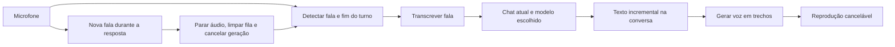

# Modo de voz do Claude e adaptação ao Comet

Análise em 16/10/2026. Escopo: experiência de conversa por voz da página indicada pelo usuário e requisitos para reproduzi-la no Comet. Nenhum código de produto foi alterado.

## Conclusão

A experiência documentada do Claude combina conversa contínua, transcrição, resposta falada, detecção de fim de fala e interrupção quando o usuário retoma a palavra. O Comet possui ditado e chat textual incremental, mas ainda não possui uma sessão de conversa por voz.

É possível projetar uma experiência equivalente aproveitando o chat atual. Esta análise não confirma a implementação interna do Claude: não houve captura de uma sessão de voz autenticada.

## Evidências e cobertura

Os identificadores abaixo são referências deste relatório; não são Evidence IDs do REA.

| Ref. | Evidência | O que sustenta | Limite |
| --- | --- | --- | --- |
| WEB-1 | [Documentação oficial do Claude](https://support.claude.com/pt/articles/11101966-usar-modo-de-voz) | Fluxo funcional de voz, interrupção e continuidade do chat | Descrição do produto; não é observação da conta do usuário |
| ENV-1 | Consulta da página fornecida: HTTP 403; consulta web também não acessível | A página não ficou disponível para inspeção pública | Não revela conteúdo nem implementação |
| ENV-2 | Inspeção do processo principal do Chrome | Processo aberto sem parâmetro remote-debugging-port | Não estabelece uma conexão de inspeção nem identifica abas |
| ENV-3 | rea-agents 6.4.0 doctor --client codex --json | Registro MCP REA ausente; CLI executável disponível por npx | Diagnóstico, sem evidência de execução do Claude |
| CODE-1 | frontend/controllers/dictation.ts | Reconhecimento e visualização do microfone atuais | Análise estática |
| CODE-2 | frontend/controllers/computer.ts e computer-service.ts | Envio, bloqueios da interface e resposta incremental | Análise estática |
| CODE-3 | server/ai/index.ts e conversations.ts | Cancelamento, persistência e contexto | Análise estática |
| CODE-4 | server/ai/openrouter.ts | Integração atual de texto/imagens | Não é levantamento das capacidades de todos os modelos disponíveis |

Não foram capturados áudio, cookies, credenciais, mensagens privadas ou tráfego autenticado. Não foram alterados o perfil do Chrome nem a configuração MCP. Computer Use não expôs o node_repl exigido pela skill nesta sessão.

## Comportamento do Claude confirmado pela documentação

O botão de ondas ativa a conversa por voz na web. A fala aparece como texto, a resposta acontece ao terminar o turno e o modo continua até ser encerrado. O modo mãos livres lida com pausas e permite interromper falando novamente; há também uma modalidade de pressionar para falar. Voz e texto compartilham contexto e as transcrições ficam no histórico. Voz, idioma e modelo podem ser escolhidos. [Fonte: WEB-1](https://support.claude.com/pt/articles/11101966-usar-modo-de-voz).

Ainda não confirmados diretamente: aparência/estados exatos na conta indicada; disponibilidade de todos os controles na web; implementação de STT e TTS; provedor; WebRTC versus WebSocket versus HTTP; codec; frequência de amostragem; limiar de silêncio; sincronização de áudio/texto; latências. A documentação não permite deduzir esses detalhes.

## O que já existe no Comet

- `frontend/controllers/dictation.ts:7`: SpeechRecognition/webkitSpeechRecognition. Em 149–165, usa pt-BR, continuous e interimResults e preenche a textarea. O botão enviar durante o ditado apenas conclui a escuta (122–128); não envia automaticamente a mensagem.
- `frontend/controllers/dictation.ts:58`: getUserMedia e AudioContext alimentam o medidor de volume/equalizador. Esse fluxo não envia áudio ao backend do Comet. O serviço SpeechRecognition do navegador é separado; isso não significa reconhecimento inteiramente local.
- `frontend/controllers/computer.ts:283`: o microfone fica desabilitado durante a resposta da IA, impedindo interrupção por voz com a interface atual.
- `frontend/controllers/computer-service.ts:16`: o chat recebe eventos NDJSON, incluindo delta, thinking, search e done. A resposta textual já chega em partes.
- `server/ai/openrouter.ts:96`: a integração atual trabalha com texto/imagens e interpreta texto/raciocínio. Não implementa entrada ou saída de voz.
- Busca limitada a frontend, server e app não encontrou reprodução/TTS nem uma sessão baseada em WebRTC, WebSocket ou AudioWorklet.

A API SpeechRecognition tem disponibilidade limitada entre navegadores e pode usar reconhecimento remoto, inclusive no Chrome. Não é uma base suficiente, sozinha, para prometer a mesma compatibilidade e qualidade em todos os dispositivos. [MDN](https://developer.mozilla.org/en-US/docs/Web/API/SpeechRecognition).

## Arquitetura proposta para o Comet — decisão de projeto, não descoberta sobre o Claude

1. Manter o botão de ditado e adicionar uma entrada distinta para conversa por voz. Mostrar estados claros: conectando, ouvindo, processando, falando, microfone pausado e erro. O modo encerra explicitamente e libera os recursos do microfone ao sair.
2. Capturar áudio com cancelamento de eco e supressão de ruído quando suportados; detectar presença de fala e finalização do turno. Um simples limiar de volume também reage a ruído e ao próprio alto-falante, portanto precisa de validação real. [Restrições de captura no navegador](https://developer.mozilla.org/en-US/docs/Web/API/Media_Capture_and_Streams_API/Constraints).
3. Mostrar transcrição parcial; enviar exatamente uma vez quando houver uma fala concluída. Separar detecção de atividade vocal de decisão sobre o fim do pensamento; silêncio curto não deve enviar uma frase incompleta imediatamente.
4. Reaproveitar o modelo selecionado, a conversa, os anexos compatíveis e a pesquisa já existentes. Preparar o texto destinado à fala sem ler marcadores Markdown ou URLs extensas literalmente. Isso não exige alterar a resposta visual.
5. Gerar e tocar trechos coerentes na ordem correta, sem esperar toda a resposta terminar. Controlar a fila e identificar cada turno; descartar eventos atrasados de um turno cancelado.
6. Ao detectar nova fala, parar imediatamente a reprodução, esvaziar a fila e cancelar geração e síntese pendentes. Voltar a ouvir mantendo a fala inicial do usuário.
7. Registrar separadamente texto gerado, texto entregue na interface e progresso aproximado do áudio reproduzido. Progresso de reprodução não prova que a pessoa ouviu. Definir como o trecho entregue entra no contexto seguinte e marcar explicitamente a interrupção.

## Dois ajustes obrigatórios no fluxo atual

**Cancelar a conexão não basta.** `server/ai/index.ts:105` mantém a geração de chats salvos mesmo quando o navegador desconecta. O novo fluxo deve chamar o cancelamento explícito em `/api/ai/chat/cancel`, além de parar o áudio local. O controle de concorrência por usuário também exige aguardar a liberação antes de começar a próxima geração.

**O contexto atual perde o turno interrompido.** `server/ai/conversations.ts:78` recupera apenas turnos completed. A adaptação deve preservar a pergunta e representar adequadamente o trecho da resposta entregue, sem marcar toda uma resposta inacabada como completed. Essa mudança precisa ser específica e testada para não afetar os chats de texto e o modo anônimo.

## OpenRouter e escolha de áudio

A documentação atual oferece transcrição por `/api/v1/audio/transcriptions` e síntese por `/api/v1/audio/speech`. A primeira descreve envio de áudio e retorno JSON; isso não demonstra uma sessão bidirecional contínua ou transcrições parciais em tempo real. A síntese documenta resposta de áudio em fluxo. [STT](https://openrouter.ai/docs/guides/overview/multimodal/stt), [TTS](https://openrouter.ai/docs/guides/overview/multimodal/tts).

Assim, podemos manter os modelos de chat do seletor e escolher separadamente reconhecimento e voz. Para STT em tempo real, é necessário confirmar o suporte efetivo do serviço escolhido; enviar gravações ao final de cada turno é uma alternativa com outras características de latência. Modelos gratuitos de texto não garantem reconhecimento ou síntese gratuitos. Nenhum fornecedor, modelo de áudio ou custo foi escolhido ou testado nesta investigação.

## Verificação necessária antes de chamar de equivalente

- Permissão negada, ausência de microfone, falha de rede e saída da página liberam todos os recursos.
- Pausa curta não encerra a fala; fala concluída gera uma única mensagem.
- Interromper no meio da resposta para o som, cancela requisições e não toca trechos antigos depois.
- O próprio áudio da IA não dispara novas mensagens.
- Alternar voz/texto e interromper preserva o contexto correto; anônimo continua sem persistência indevida.
- Medir tempo de fim de fala até primeiro áudio, duração da fila e tempo para parar áudio. Sem medições, não prometer a latência do Claude.
- Validar em português, com e sem fones, em desktop e celular. O teste existente em tests/frontend/recent-chats.test.cts:1295 simula SpeechRecognition e falha de getUserMedia: não mede áudio real.

## Pendência para concluir a engenharia reversa do Claude

Falta uma sessão autenticada inspecionável da página indicada, ou uma captura sanitizada feita durante a ativação, fala, resposta e interrupção. O próximo passo técnico é conectar um navegador por CDP em loopback e usar a descoberta/captura passiva do REA restrita à origem claude.ai. A captura deve preceder a interação observada; não recupera tráfego passado. Login e eventuais permissões permanecem a cargo do usuário.

Situação: comportamento documentado e código do Comet analisados; execução, rede e código entregue do modo de voz do Claude ainda não observados.